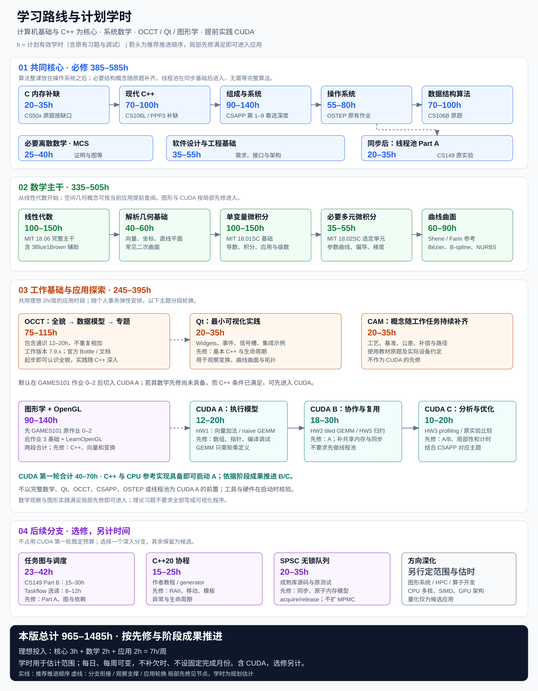

# 学习计划

2026-11-16 经用户审核通过并定稿。**以计算机基础知识构成最小、连贯的共同核心。** 以先修关系和原有习题、作业、实验的成果推进，每周核心 3h、数学 2h、应用 2h 为理想投入，不设固定完成月份或年限。

资料入口见 [RESOURCES](RESOURCES.md)，实际进度与下一步见 [STATUS](STATUS.md)。[带学时流程图](docs/learning-roadmap.svg) · [可缩放版](docs/learning-roadmap.html)。

## 学习定位与执行方式

以 C++ 为主要实践语言，理解程序执行、数据表示、内存、操作系统、资源管理与基本并发，建立可迁移到不同产品与方向的基础。结合当前 CAM 工作，优先建立 OCCT 全局认识，逐步补齐空间数学、几何表示和加工概念。Qt 用于可视化实践，图形学与 CUDA 满足局部先修后提前探索。

| 层次 | 内容 |
|---|---|
| 共同核心，必修 | C/C++、组成与系统、操作系统、数据结构算法、必要离散数学、软件设计、基本并发与线程池 |
| 当前路线基础 | 线代、解析几何、微积分、曲线曲面、OCCT、CAM 概念 |
| 明确安排的入门探索 | Qt、GAMES101、LearnOpenGL、CUDA 第一轮 |
| 进阶选修 | 任务图、Taskflow、协程、SPSC、图形系统、HPC、算子开发、复杂几何算法 |

课程选择参考 [CS 自学指南](https://csdiy.wiki/CS学习规划/)和 [Teach Yourself CS 中文版](https://github.com/izackwu/TeachYourselfCS-CN/blob/master/TeachYourselfCS-CN.md)，按基础、先修和在职时间取舍，不叠加两套完整课程。岗位和开源项目辅助理解用途，不按学历标签、招聘关键词或 star 数增加必修。

岗位观察来源限 BOSS直聘、前程无忧、猎聘、公司官网，地区限江苏、浙江、上海、北京、广州、合肥、深圳。薪资须高于目前 17k；固定月薪 30k 及以下优先双休、约 8 小时，严格高于 30k 时放宽工时偏好。标价不是实际 offer，跨过 30k 的区间仍需确认实际薪资；未披露工时不视为已符合。

| 时段 | 每周理想投入 | 执行方式 |
|---|---:|---|
| 计算机核心 | 3h | 一个主要单元，工程与离散数学按当前需要嵌入 |
| 数学 | 2h | 一个主要数学单元，保持连贯 |
| 应用 | 2h | OCCT、Qt、图形学、CUDA 按连续小阶段轮换 |
| 合计 | 7h | 随个人事务弹性调整 |

学时用于估计内容量，不是每周必须达到的指标。忙时减少、空闲时集中推进，不补欠时，不要求每日平均分配。保持一个主要核心单元、一个主要数学单元、一个应用主题。

## 一、计算机共同核心：385–585 小时

主顺序：**C 内存补缺与 C++ 基础 → CSAPP → OSTEP → 数据结构与算法。** 线程池在同步基础具备后进入，无需等待完整算法课程。箭头表示推荐推进顺序，不要求整门课程全部完成才衔接下一单元。

| 单元 | 主资源 | 主要范围与原有实践 | 小时 |
|---|---|---|---:|
| C 内存补缺 | CS50x C 部分 | 函数、数组、指针、动态内存；Week 1–5 按缺口选原题 | 20–35 |
| 现代 C++ | CS106L Spring 2025；PPP 第 3 版补缺 | 生命周期、资源管理、容器、值语义、基本泛型；原作业与教材习题 | 70–100 |
| 组成与系统 | CSAPP 第 3 版 | 数据表示、机器执行、CPU、缓存、链接、进程、虚拟内存；原书练习 | 90–140 |
| 操作系统与同步基础 | OSTEP，衔接 C++ 同步设施 | 虚拟化、调度、并发、持久化；原作业、模拟器与代码练习 | 55–80 |
| 数据结构算法 | CS106B Spring 2025 | 递归、复杂度、线性结构、哈希、树、堆、排序、图；原 section exercises 与代表性作业 | 70–100 |
| 线程池 Part A | CS149 Assignment 2 | 创建线程、自旋池、休眠池；原框架和测试比较 | 20–35 |
| 必要离散数学 | MIT 6.042J / MCS | 逻辑、归纳、不变量、递推、图、基本计数和概率；对应原题 | 25–40 |
| 软件设计与工程基础 | Sommerville《软件工程》第 10 版等 | 需求、模块、接口、耦合、架构取舍与轻量管理；原分析与设计题 | 35–55 |
| 合计 | | | 385–585 |

### C++：支撑系统学习的基础

先掌握函数、数组、指针、基本对象使用、生命周期和调试，再进入 CSAPP；其余现代 C++ 内容随原题继续。已有能力用原题确认，能独立完成并解释的部分加快通过，只选部分单元时如实记录范围。

| 深度 | 内容 |
|---|---|
| 必须扎实 | 类型、初始化、引用、const、作用域、构造析构、对象不变量、RAII、所有权与借用 |
| 必须能够使用 | 复制移动、智能指针、容器、迭代器及失效规则、标准算法、lambda、简单模板、错误处理 |
| 常用现代设施 | 结构化绑定、optional、variant、string_view、span、if constexpr |
| 后续基础应用 | concepts、ranges 基本使用；线程、锁、条件变量、停止与退出机制 |
| 进阶选修 | 协程、复杂模板、精细原子内存序、无锁算法、模块专题 |

C++11/14/17/20 按机制学习，不逐版本重复修读。CS106L 未覆盖的设施按主题补资料；CS106B 教学库与 STL 分清，沿用原框架。

### CSAPP：在算法整课之前理解机器与内存

| 顺序 | 范围 | 理解目标 |
|---|---|---|
| 1 | 第 1–2 章 | 程序执行概览、整数、浮点和地址表示 |
| 2 | 第 3 章重点 | 寻址、控制流、函数调用、栈和结构体布局 |
| 3 | 第 4 章选学 | 寄存器、数据通路、流水线与依赖 |
| 4 | 第 5–6 章重点 | 优化限制、局部性、缓存、延迟与带宽 |
| 5 | 第 7–8 章重点 | 编译链接、符号、进程、异常控制流、系统调用 |
| 6 | 第 9 章重点 | 地址翻译、页表、TLB、映射与动态分配 |

原书练习为主；Cache Lab 按需选修并另估时间。机器级程序侧重读懂典型编译结果，不要求完整 CPU 实现。

### OSTEP 与算法后置的局部先修

学习进程、调度、地址空间、线程、锁、条件变量、数据竞争、死锁，以及文件、目录、文件系统和崩溃恢复基础。与 CSAPP 重合内容衔接学习，原 C/POSIX 作业保留课程语言。

算法整课后置，但系统原题需要数组、结构体、指针与链式结构、栈、队列、基本树结构，或扫描和索引等成本概念时，先补足当前需要，不另设完整先修课。

随后通过 CS106B 系统学习递归、复杂度、哈希、树、堆、排序和图算法。必要离散数学随证明、不变量和数据关系进入，在算法阶段再补对应主题。

### 软件设计与工程基础

先学需求、边界、业务规则与任务拆分；掌握类和生命周期后学模块、接口、信息隐藏、所有权、状态与耦合；系统阶段进入架构取舍、风险、估时、变更、迭代与发布。

《软件工程》第 10 版选第 4、5、6、7、22、23 章相关主题，译本按章名核对；维护、构建与发布按需查阅。《软件设计的哲学》补复杂性、深浅模块、接口、错误处理与设计判断，CS190 原代码审查练习按需使用。

35–55 小时已计入核心，不另开完整并行课程，不另设架构项目；线程池等原实践提供实际设计观察对象。

## 二、数学主干：335–505 小时

**从线性代数开始。** 主要顺序：线性代数 → 解析几何基础 → 单变量微积分 → 必要多元微积分 → 曲线曲面。

| 单元 | 主资源 | 范围与要求 | 小时 |
|---|---|---|---:|
| 线性代数 | MIT 18.06 Spring 2010 | 系统学习方程组、矩阵、子空间、正交、最小二乘、特征值、SVD 等主干 | 100–150 |
| 解析几何基础 | 吕林根、许子道《解析几何》第 5 版 | 向量、坐标、轨迹与方程、直线平面、常见二次曲面；一般分类理论后置 | 40–60 |
| 单变量微积分 | MIT 18.01SC | 系统学习导数、积分、应用和级数基础 | 100–150 |
| 必要多元微积分 | MIT 18.02SC | 参数曲线、偏导、链式法则、梯度、切平面等连续单元 | 35–55 |
| 曲线曲面 | Shene 讲义；Farin《Curves and Surfaces for CAGD》第 5 版参考 | Bézier、B-spline、NURBS、连续性、参数曲面与法向 | 60–90 |

3Blue1Brown 与线代对应主题配合观看，时间包含在线代预算内。计算和推导使用原题，不用视频直觉替代练习。18.06 原作业匹配 Strang 第 4 版题号，题面需对应教材；18.01SC、18.02SC 使用公开原题。曲线曲面使用 Shene 原有练习，Farin 按当前主题查阅。

应用遇到叉积、直线平面时，可先查解析几何对应内容与原题，后续正式学习时直接衔接；学到向量、矩阵和变换即可开始图形学。导数支持参数曲线、切向和采样，偏导支持曲面切向与法向；参数曲面知识在 CAGD 中衔接，不假定线代已覆盖。

CUDA 向量加法不等待微积分，GEMM 先理解矩阵乘法定义。方向判定、相交和包含关系等计算几何内容随当前题目补齐，完整计算几何课程选修。数学不强制编程或可视化；浮点表示、舍入和误差从 CSAPP 起步，在几何与 GPU 实践中延续。

## 三、OCCT、Qt 与 CAM：115–185 小时

### OCCT：75–115 小时

先全貌、再数据模型、再按任务深入。通识 12–20 小时已包含在总预算内，认识 gp、Geom、TopoDS，几何与拓扑，建模算法、网格、显示与选择，以及数据交换、装配、属性和 OCAF。

实践以工作版本 **7.9.x** 为基线，开课登记实际补丁版本。优先使用固定版本 Introduction、Modeling Data、Bottle Tutorial 与官方示例，Quaoar 概览辅助。旧官网链接可能跳转最新版，不能据此声称兼容工作版本。

随后理解曲线与边、曲面与面、参数范围、p-curve、Location、Orientation、共享、容差、离散误差与交互变换。联系轮廓、表面、孔、参考拾取、移动旋转、显示与网格任务，先明确几何含义和业务规则。复杂修复与内核源码由真实问题触发。

### Qt：20–35 小时

学习支持实践的 Widgets、布局、事件、信号槽、对象关系和窗口集成。先官方教程，再参考 OCCT Qt 示例，OpenGL 到对应阶段后按需看 Hello GL2；不把该示例当作 OCCT 窗口集成的通用替代。

| 概念 | 在已有示例中观察 |
|---|---|
| 坐标与矩阵 | 点、方向、坐标系、平移旋转 |
| 参数曲线 | 参数、位置和切向 |
| 曲面偏导 | UV、切向和法向 |
| 曲线曲面表示 | 控制点、节点、权重 |
| B-rep | 底层几何和裁剪边界 |

复用原教程和示例，不另外建设完整可视化软件，不要求所有数学原题编程。运行完整示例、理解流程与独立完成原题分别记录。

### CAM 概念：20–35 小时

学习工艺、定位基准、装夹、公差、割缝补偿、设计轮廓与加工路径、单位与坐标约定。使用此前制造课程和教材原题，运动学、RTCP 及设备语义按工作需要查阅。

圆柱面识别不自动等于符合业务定义的标准孔；需要联系产品规则与加工约束。深入几何内核不是图形学或 CUDA 的前置。

## 四、图形学与 OpenGL：90–140 小时

### 第一段：GAMES101 原作业 0–2

先修为基本 C++、向量、点积叉积、矩阵和变换。学习相机、投影、光栅化、重心坐标、插值、深度测试与采样，沿用官方框架，不另写第二套同范围光栅器。

### 第二段：着色与 OpenGL

GAMES101 基本光照、材质、纹理和作业 3 基础部分；LearnOpenGL 的窗口与上下文、缓冲区、shader、变换、纹理、光照、模型加载、深度、混合与帧缓冲。课程几何内容与曲线曲面衔接，作业 4 按需选做；Qt/OpenGL 集成按实践需要进入，虎书对应章节按需查阅。

不要求修完整门 GAMES101 或 LearnOpenGL 整站。光追、PBR 和复杂渲染架构留作后续选修。默认第一段原实践完成后可轮换进入 CUDA A；图形学课程本身不是 CUDA 的技术先修。

## 五、CUDA 第一轮：明确安排 40–70 小时

在应用时段完成当前一小段原实践后，C/C++ 编译调试、数组指针、分配释放、生命周期、边界与 CPU 参考实现具备，即可进入 A。启动时核验可用兼容 GPU、驱动、Toolkit 和工具。

不等待完整数学、OCCT、Qt、CSAPP、OSTEP、算法或线程池课程，不设固定启动月份。若图形学暂缺数学先修，而 C++ 条件已满足，可先进入 CUDA。

| 阶段 | 原有实践 | 先修与重点 | 小时 |
|---|---|---|---:|
| A：执行模型与传输 | OLCF HW1 向量加法、naive GEMM | C/C++ 基础、矩乘定义；索引、线程映射、传输与错误检查 | 12–20 |
| B：协作与复用 | HW2 tiled GEMM、HW5 归约示例与 sum 改 max 原题 | A；共享内存、同步、分块、归约与浮点顺序 | 18–30 |
| C：分析与优化 | HW3 profiling，在已有实验中比较实现 | A/B；局部性、带宽与计时，联系 CSAPP 对应主题 | 10–20 |
| 合计 | | | 40–70 |

PMPP 用于对应主题讲解，OLCF 提供原培训实验，不冒称 PMPP 第 5 版配套作业。原检查覆盖不同，必要边界验证标为补充，不包装成教师原题；培训旧集群账户不作为自学条件。

A 的成果是解释映射、传输与结果检查；B 是解释数据复用和同步位置、定位相关错误；C 是读取一次性能报告，在原实验中比较优化前后结果，区分 kernel 与整体开销。先正确性再性能，Compute Sanitizer 按范围辅助，Nsight Systems 看整体开销，Nsight Compute 看 kernel。

A/B/C 在阶段边界可与图形学、OCCT 轮换。入门不等同专业 GPU 优化能力；后续路线按选择确定。

## 六、线程池与进阶分支

### 线程池 Part A：必修 20–35 小时

已计入核心。C++ 生命周期、线程、互斥锁、条件变量和数据竞争具备后，完成 CS149 原题中的创建线程、自旋池、休眠池与测试比较，理解任务分配、完成条件、共享状态和退出。

可安排在 OSTEP 同步主题后、完整算法课之前，核心时段一次只推进一个主要实践。本地原测试不等于课程全部隐藏测试和评分环境；平台与参考程序在启动时核对，不额外另造同类线程池项目。

### 后续选修

| 分支 | 先修与范围 | 额外小时 |
|---|---|---:|
| CS149 Part B | Part A、图与依赖；异步任务调度 | 15–30 |
| Taskflow 选读 | 基本任务图、Executor、对应测试 | 8–12 |
| C++20 协程 | RAII、移动、基本模板、异常；作者教程与 generator | 15–25 |
| SPSC 队列 | 同步、原子内存模型、acquire/release；源码与原测试 | 20–35 |

不要求重写完整成熟库或异步运行时。协程用作者教程，理解挂起、恢复、promise、句柄、协程帧和销毁；不自动产生并行加速。SPSC 限单生产者单消费者，关注发布可见性、对象生命周期、缓存行和测量；无锁不保证更快或所有操作不等待。两者分别选择，复杂 MPMC 和内存回收后置。

完成图形与 CUDA 入门后，再选一个主要深入方向：

- 图形系统：渲染算法、引擎结构、GPU 资源、调试和性能。
- 并行计算/HPC：CPU 多核、SIMD、OpenMP，按负载进入 MPI、数值计算或 GPU 加速。
- GPU 算子：架构、布局、并行原语、库基线、融合，再进入 CUTLASS 或自定义算子。

库基线可按主题使用 CUB/Thrust、cuBLAS，应用需要时再学张量与框架机制。CS149 Circle Renderer 可作为图形与并行计算交叉的原作业候选，替代重复入门实践。量化研究与金融计算仅为候选应用，深入范围与时间届时再定。

## 七、按阶段成果推进

以下判断来自已经安排的原题、作业和实验，不增加独立考试。

| 阶段 | 原有实践提供的证据 | 可以衔接 |
|---|---|---|
| 编程起步 | 处理基本数组、指针和生命周期，能够编译调试 | CSAPP；Qt、CUDA 按局部条件进入 |
| 机器与内存 | 联系表示、函数调用、地址和缓存解释原题 | OSTEP；CUDA 性能主题 |
| 操作系统 | 理解进程、地址空间、同步和文件基础 | 线程池、数据结构算法课程 |
| 数据结构算法 | 完成选定原题，说明边界、复杂度和正确性理由 | 更复杂几何、调度与并行算法 |
| 应用探索 | 完成选定 OCCT 示例、图形原作业和 CUDA 阶段实验 | 选择一个深入方向 |

遇到缺口先补当前必需内容，其他满足先修的部分可以继续。排错、验证与性能分析随原实践形成：断点、调用栈、变量和内存观察、可复现输入，以及构建配置、输入规模、预热、重复和计时范围，不凭一次测量下结论，不另堆重复项目。

AI 可辅助解释、实现和测试；个人负责需求、约束、关键概念、结果标准与关键路径理解。独立完成、提示后完成和 AI 生成分别记录，沿用看过、能够解释、能够独立实现、能够分析正确性与性能四级，不用运行成功直接认定掌握。

## 八、总学时与下一步

| 范围 | 预计有效学时 |
|---|---:|
| 共同核心，含离散数学、工程基础、线程池 Part A | 385–585 |
| 数学主干，含 3Blue1Brown | 335–505 |
| OCCT、Qt 与 CAM，含 OCCT 通识 | 115–185 |
| 图形学与 OpenGL | 90–140 |
| CUDA 第一轮 | 40–70 |
| 完整路线 | 965–1485 |

预算含选定阅读、原题、实验、调试和整理，后续选修另计，复用部分不重复相加。它表示内容规模，不对应固定完成日期。实际耗时出来后再修正范围预算，不根据理想周投入强制赶进度。

起步三线：

1. 核心：通过 CS50x 原题确认 C 内存缺口，接续 C++ 基础，再进入 CSAPP。
2. 数学：从 MIT 18.06 开始，配合 3Blue1Brown，空间几何按应用需要局部补充。
3. 应用：先建立 OCCT 全貌，具备基本 C++ 后进入 Qt 和对应示例。

## 成果与流程图维护

资源和题目性质见 [RESOURCES](RESOURCES.md)。实际开课才在 courses 下创建课程目录，课程 README 记录版本、范围、成果与下一步；根 [STATUS](STATUS.md) 是唯一总进度入口。完整示例、作者教程和成熟库阅读不冒称独立 lab，局部选学不写成整课完成。

[SVG 流程图](docs/learning-roadmap.svg)是带学时的视觉入口，[HTML 可缩放版](docs/learning-roadmap.html)用于离线查看；范围、学时和先修调整时同步更新两版，文字安排以本文件为准，实际完成情况以 STATUS 与课程证据为准。

公开内容、课程许可和 Git 同步遵守 [AGENTS](AGENTS.md)，跨电脑步骤见 [README](README.md#两台电脑同步与接续学习)。只保存允许公开的内容、合成模型或许可明确的数据，不复制公司代码、客户数据和受限课程答案。
