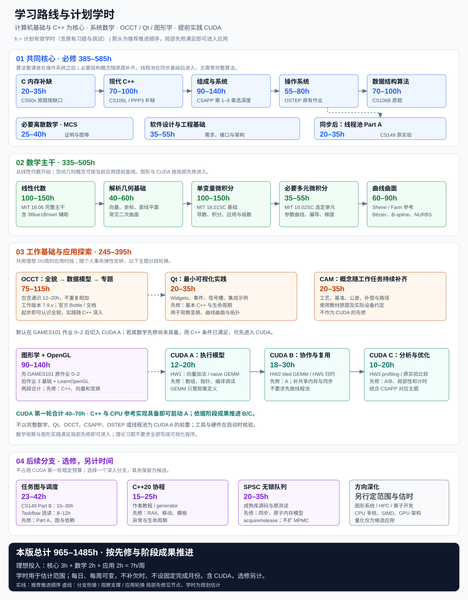

# self-Learning

**以计算机基础知识构成最小、连贯的共同核心。** 以 C++ 为主要实践语言，理解程序执行、数据表示、内存、操作系统、资源管理与基本并发，建立可迁移的基础。

共同核心按 **C 内存补缺与 C++ 基础 → CSAPP → OSTEP → 数据结构与算法** 推进。系统原题涉及的必要结构概念随题补齐；线程池 Part A 在同步基础具备后进入，不等待完整算法课程。软件设计与必要离散数学嵌入核心时段。

数学从 **线性代数 → 解析几何基础 → 单变量微积分 → 必要多元微积分 → 曲线曲面** 推进，3Blue1Brown 配合线代。应用需要的空间几何可提前查对应原题。OCCT 以工作版本 7.9.x 先通识再专题，Qt 辅助可视化；图形学与 CUDA 满足局部先修后提前探索。

| 层次 | 范围 |
|---|---|
| 共同核心，必修 | C/C++、CSAPP、OSTEP、CS106B、必要 MCS、软件设计与工程基础、C++ 同步和 CS149 线程池 Part A |
| 当前路线基础 | 线代、解析几何、微积分、曲线曲面；OCCT、CAM 概念 |
| 明确安排的入门探索 | Qt、GAMES101 作业 0–2 与 3 基础、LearnOpenGL、CUDA 第一轮 |
| 进阶选修 | Part B、Taskflow、协程、SPSC、图形系统、HPC、算子开发、复杂几何算法；量化为候选应用 |

C++11/14/17/20 按机制学习，重点为生命周期、RAII、所有权、容器与基本泛型。深入几何内核不是其他方向的前置。岗位与开源项目用于理解用途，不按学历标签、职位关键词或 star 数扩大必修。

每周理想分配为 **核心 3h、数学 2h、应用 2h，共 7h**。随个人事务调整，不要求每日平均或每周达标，不补欠时，不设固定完成月份或年限。保持一个主要核心单元、一个主要数学单元、一个应用主题，按原有习题和实验成果决定衔接。

共同核心 385–585h，数学 335–505h，OCCT/Qt/CAM 115–185h，图形学/OpenGL 90–140h，CUDA 第一轮 40–70h，合计 **965–1485h**。包含选定阅读、原题、调试与整理，后续选修另计；学时估计内容量，不是工期承诺。

[可缩放流程图](docs/learning-roadmap.html) · [SVG 原图](docs/learning-roadmap.svg)



| 入口 | 职责 |
|---|---|
| [学习计划](LEARNING_PLAN.md) | 范围、学时、先修与阶段成果 |
| [当前状态](STATUS.md) | 实际进度、课程索引、下一步与同步入口 |
| [学习资源](RESOURCES.md) | 教材、课程、原题与示例入口 |
| [协作规则](AGENTS.md) | 读取顺序、证据、公开边界与 Git 规则 |

本版完整方案已于 **2026-11-16 审核通过并定稿**。核心已启动 [CS50x C 补缺](courses/cs50x-c/README.md)，首题待独立尝试，实际成果以 [STATUS](STATUS.md) 为准；文档登记不推进学习日。随后接 C++；数学从 MIT 18.06 与 3Blue1Brown 开始；应用启动 OCCT 全貌。其他课程实际开课才创建目录。

课程成果按 courses 下的独立目录保存，总进度只维护根 STATUS。使用原习题、作业、实验及官方示例，区分独立完成、提示后完成和 AI 生成，运行示例不直接等同独立完成。个人负责需求、约束、关键概念、结果标准和关键路径理解。

换电脑或会话时同步本仓库，再读 STATUS 和课程 README；结束时整理、提交、推送并核对远程。审核状态和同步状态分开，以 Git 实际结果为准。

## 两台电脑同步与接续学习

两台电脑各保留一份本仓库，通过 GitHub 同步计划、进度、笔记和代码。学习安排以最新 [STATUS](STATUS.md) 为入口，具体成果以课程文件为依据；聊天记录和临时交接文件不作为接续依赖。尽量在一台电脑提交并推送后，再换另一台继续同一任务。

### 首次在另一台电脑准备

在自己选定的父目录打开终端，首次克隆：

```powershell
git clone https://github.com/W-yf/self-Learning.git
cd self-Learning
git status --short --branch
```

已有克隆时直接进入原目录，按下节同步，不重复克隆。随后在 Codex 中打开仓库目录，用下方提示词开启对应角色的新对话。

编译器、SDK、依赖和本机编辑器设置不会随 Git 自动安装；只按当前课程 README 配置所需工具。机器专用配置留在本地，不把私人路径、凭据或公司代码及客户数据写入公开仓库。

### 每次学习前

先在仓库根目录检查：

```powershell
git status --short --branch
git branch -vv
```

确认当前是日常使用的 `main`，且没有待处理的学习改动，再同步：

```powershell
git pull --ff-only
git log -1 --oneline
```

若在其他分支，先核对它的用途，不盲目切换。发现本地修改、未推送提交或分叉时，先保留并核对内容；不要用强推、强制重置或删除文件来“对齐”。已确认仅供本机使用且不冲突的未跟踪配置可以保留。拉取失败时说明“同步未核验”，不把本地版本当作远程最新版本。

同步后依次读适用的 AGENTS.md、README、STATUS 和当前课程 README；首次接手或范围有变化时再读 LEARNING_PLAN、RESOURCES。课程尚未启动时以 STATUS 的下一步为准，实际开课才创建目录。

### 学习结束与换电脑前

1. 整理本轮课程笔记、代码及必要验证，更新课程 README 的接续任务和根 STATUS 的摘要、成果链接、下一步。文档整理本身不推进学习日或掌握层级。
2. 检查 `git status --short` 和 `git diff`，只选择本轮允许公开的成果。逐个使用 `git add -- 文件相对路径` 暂存，其中“文件相对路径”替换为已审阅的实际路径；不要无差别暂存本机配置。
3. 审阅暂存区，提交并推送：

```powershell
git diff --cached --stat
git diff --cached
git diff --cached --check
git commit -m "Record learning progress and next steps"
git push origin main
```

上述命令按顺序执行，检查或命令失败时先处理原因，再继续。无实际改动时无需提交。若发现异常截断或大范围无关差异，先核对完整文件内容与 Git 对象，不据异常 diff 恢复文件。

4. 推送成功后核对：

```powershell
git rev-parse HEAD origin/main
git ls-remote origin refs/heads/main
git status --short --branch
```

本地 HEAD、origin/main、远程 main 的提交应一致，已跟踪的本轮改动应全部提交。未提交的内容不会出现在另一台电脑；已提交但未推送的内容也只在当前电脑。推送失败时保留本地成果并说明尚未同步；认证问题使用本机正常登录方式或已授权的 GitHub 连接处理，不把凭据写入文档。

### 新对话接手提示词

**课程学习会话**：复制以下内容，可在开头补充本次指定课程或主题；没有指定时按 STATUS 接续。

```text
这是课程学习会话，请从当前 self-Learning 仓库接手。
先读取适用的 AGENTS.md，检查本地修改、分支和上游，保留未同步内容；条件允许时快进同步本仓库远程，失败则明确说明。
读取 README、根 STATUS、LEARNING_PLAN，以及当前课程 README 和相关笔记/练习；需要资料时查 RESOURCES。
按 STATUS 的下一步继续，以课程或书籍原有习题、作业和实验推进。课程尚未启动时，实际开课再创建目录并登记版本。
根据仓库证据确认已完成范围，不依赖旧聊天，不把 AI 生成内容当作我的独立成果。
小节结束整理精简笔记，结束时更新课程接续任务和总 STATUS。
本会话授权你在检查后提交并推送本轮学习成果与必要进度文档，核对远程结果；保留无关改动，不强推或重写历史。
```

**管理会话**：用于调整计划、汇总课程成果和维护仓库总览。

```text
这是管理会话，请从当前 self-Learning 仓库接手。
先读取适用的 AGENTS.md，检查本地修改、分支和上游，保留未同步内容；条件允许时快进同步本仓库远程，失败则明确说明。
读取 README、根 STATUS、LEARNING_PLAN、RESOURCES、最新日期日志和相关课程 README/成果证据。
按本次请求维护计划、课程优先级、总进度和接续入口；依据真实证据更新，不因文档整理推进学习日或掌握层级。
本会话授权你在检查后提交并推送本轮管理改动，核对远程结果；保留无关改动，不强推或重写历史。
```

两份提示词最后一句包含本会话提交/推送授权；若只想讨论或审核草稿，发送前将其替换为“本轮仅讨论或修改本地草稿，暂不提交或推送”。
